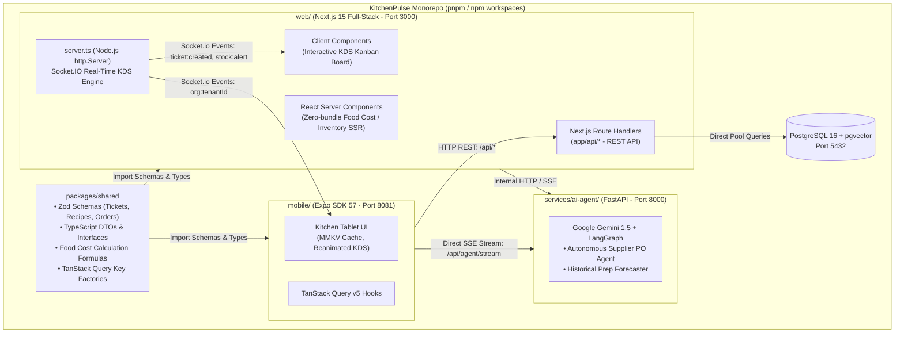

# 🏢 KitchenPulse Multi-Tenant Organization & RBAC Implementation Plan

## 📌 Project Overview
Implement multi-tenant client/organization isolation (e.g., hotel or restaurant name), role-based permissions with **Admin** and **Owner** roles having full access to user management, stock, and reports, and strict authentication guards preventing dashboard display without login across both **Web** and **Mobile** platforms.

---

## 🏛️ System Architecture & Data Model

```
                    ┌───────────────────────────────┐
                    │    Organizations (Clients)    │
                    │  (e.g., Grand Palace Hotel)   │
                    └───────────────┬───────────────┘
                                    │ 1 : N
        ┌───────────────────────────┼───────────────────────────┐
        ▼                           ▼                           ▼
┌───────────────┐           ┌───────────────┐           ┌───────────────┐
│     Users     │           │  Ingredients  │           │ Live Tickets  │
│(Owner, Admin, │           │  & Recipes    │           │ & Prep Logs   │
│ Staff, Chefs) │           │ (Stock/Costs) │           │ (Real-Time)   │
└───────────────┘           └───────────────┘           └───────────────┘
```

---

## 🔐 Role-Based Access Control (RBAC) Matrix

| Section / Capability | Owner | Admin | Executive Chef | Line Cook / Staff |
| :--- | :---: | :---: | :---: | :---: |
| **Kitchen Display System (KDS)** (Queue, Firing, Complete) | ✅ Full | ✅ Full | ✅ Full | ✅ Full |
| **Daily Prep & Scrap/Waste Logging** | ✅ Full | ✅ Full | ✅ Full | ✅ Full |
| **Inventory Stock Management & Thresholds** | ✅ Edit / Update | ✅ Edit / Update | 👁️ View Only | 👁️ View Only |
| **Supplier Orders & Purchasing** | ✅ Full Access | ✅ Full Access | 👁️ View Pending | ❌ No Access |
| **Ingredient Unit Cost & Profit Margins** | ✅ Full Access | ✅ Full Access | ❌ Masked / Hidden | ❌ Hidden |
| **Financial & Food Cost Reports** | ✅ Full Access | ✅ Full Access | 👁️ Operational Only | ❌ No Access |
| **AI Prep Sheet & Inventory Audit** | ✅ Trigger & View | ✅ Trigger & View | 👁️ View Prep Sheet | 👁️ View Stations |
| **User Data & Team Management** | ✅ Full (Add/Edit/Del) | ✅ Add/Edit/View | ❌ No Access | ❌ No Access |
| **Organization Branding & Settings** | ✅ Full Control | 👁️ View Details | ❌ No Access | ❌ No Access |

---

## 🚀 KitchenPluss AI Integration 4-Week Roadmap (Synced with Excel)
> Source: [`docs/KitchenPluss AI Integration Plan.xlsx`](docs/KitchenPluss%20AI%20Integration%20Plan.xlsx)


### Week 1: Python Microservice & Kitchen Data Ingestion
- [x] **Day 1: Scaffold Python/FastAPI service** **[Completed]**
  - *Task*: Scaffold services/ai-agent/ directory with Python, FastAPI, and Uvicorn. Connect it to the existing docker-compose.yml.
  - *Manager Standup Update*: "I containerized and scaffolded a dedicated Python/FastAPI AI microservice within our Docker compose stack to isolate LLM agent orchestration from the core API."
- [ ] **Day 2: Pydantic & Data Validation** 
  - *Task*: Create Pydantic models matching existing TypeScript DB models (tickets, ingredients, recipes, prep_logs).
  - *Manager Standup Update*: "I set up strict Pydantic schema validation matching our existing PostgreSQL database schema to prepare for agent state management."
- [ ] **Day 3: Gemini SDK Integration** 
  - *Task*: Integrate Gemini 1.5 Pro / Flash via the Google GenAI SDK with structured outputs.
  - *Manager Standup Update*: "I established direct Gemini SDK integration in the AI microservice with structured JSON output enforcement."
- [ ] **Day 4: Database Connection (SQLAlchemy)** 
  - *Task*: Connect the Python service to your PostgreSQL database using SQLAlchemy/asyncpg to query real inventory tables.
  - *Manager Standup Update*: "I enabled read access from the AI microservice to our production PostgreSQL database to allow live state inspection."
- [ ] **Day 5: SSE Streaming** 
  - *Task*: Expose a streaming SSE endpoint (/api/agent/stream) that the React Native app can listen to for real-time recommendations.
  - *Manager Standup Update*: "I created a Server-Sent Events (SSE) streaming endpoint in the AI service to deliver real-time token streaming to the mobile client."

### Week 2: Recipe & SOP Vector Database (RAG over Recipes)
- [ ] **Day 6: pgvector Setup** 
  - *Task*: Enable the pgvector extension in your existing PostgreSQL database (01_init.sql).
  - *Manager Standup Update*: "I enabled the pgvector extension on our PostgreSQL instance to support in-database vector embeddings without needing third-party vector DBs."
- [ ] **Day 7: Document Embedding Pipeline** 
  - *Task*: Build an embedding pipeline to index recipe instructions, allergen warnings, and prep procedures.
  - *Manager Standup Update*: "I built an automated embedding script that converts recipe steps and allergen tables into vector embeddings."
- [ ] **Day 8: Vector Similarity Search** 
  - *Task*: Implement vector similarity search (cosine distance) to answer queries like "How do I prep garlic confit safely?".
  - *Manager Standup Update*: "I implemented semantic similarity search directly in Postgres to match kitchen queries against stored prep protocols."
- [ ] **Day 9: RAG Pipeline** 
  - *Task*: Assemble the complete RAG pipeline with relevance re-ranking and source attribution.
  - *Manager Standup Update*: "I completed the RAG retrieval pipeline, grounding AI responses strictly in our validated kitchen standard operating procedures."
- [ ] **Day 10: API & Mobile Exposure** 
  - *Task*: Wire the RAG endpoint into the mobile PrepSheetScreen.tsx so chefs can ask real-time questions about recipes.
  - *Manager Standup Update*: "I exposed the RAG engine via REST and tested context retrieval for kitchen prep procedures."

### Week 3: Multi-Agent Workflows with LangGraph
- [ ] **Day 11: LangGraph Basics & State** 
  - *Task*: Install LangGraph and design the Kitchen State Graph: ChefQueryState containing conversation context, kitchen ID, and tool calls.
  - *Manager Standup Update*: "I began designing our agentic state machine using LangGraph to handle multi-step kitchen logic."
- [ ] **Day 12: Inventory Agent Node** 
  - *Task*: Implement node that uses existing supplier-mcp logic to check ingredient levels and flag impending stockouts.
  - *Manager Standup Update*: "I implemented the Inventory Agent node, enabling autonomous checks against low-stock thresholds."
- [ ] **Day 13: Supplier Order Agent Node** 
  - *Task*: Automatically drafts a purchase order if an ingredient drops below the safety margin, utilizing tool calls.
  - *Manager Standup Update*: "I added an automated supplier ordering tool that drafts purchase orders when stock reaches critical thresholds."
- [ ] **Day 14: Supervisor/Router Node** 
  - *Task*: An orchestrator LLM that inspects kitchen events and routes to either Prep Optimization or Supplier Restock.
  - *Manager Standup Update*: "I built a supervisor agent graph that routes events between inventory management, prep optimization, and order fulfillment."
- [ ] **Day 15: State Persistence** 
  - *Task*: Implement state persistence using Postgres checkpointer (langgraph-checkpoint-postgres).
  - *Manager Standup Update*: "I added PostgreSQL checkpointers to our agent workflows, ensuring conversations and active runs survive service restarts."

### Week 4: Mobile & Web Integration (Connecting the React Native Stack)
- [ ] **Day 16: Next.js Full-Stack & Shared Core** 
  - *Task*: Initialize Next.js 15 App Router and extract packages/shared core (Zod schemas, types, DTOs) to eliminate code duplication across web and mobile.
  - *Manager Standup Update*: "I initialized Next.js 15 App Router with unified API routes and extracted a shared monorepo core package for 100% DRY validation across web and mobile."
- [ ] **Day 17: Unified API Routes & Socket Server** 
  - *Task*: Migrate Express API routes to Next.js Route Handlers (app/api/*) and attach custom Socket.IO server.ts for live KDS real-time events.
  - *Manager Standup Update*: "I migrated backend routes into Next.js Route Handlers, serving both Web Server Components and the mobile Expo tablet app from a single API with live Socket.IO."
- [ ] **Day 18: React Native Bottom Sheets & DRY UI** 
  - *Task*: Build animated AI Recommendations sheet in mobile using React Native Reanimated and shared Zod schemas to review and approve draft supplier orders.
  - *Manager Standup Update*: "I created a bottom sheet interface in React Native utilizing shared Zod schemas to review and approve AI-generated supplier orders."
- [ ] **Day 19: E2E Integration & Bundle Optimization** 
  - *Task*: Verify end-to-end flow: Mobile ticket firing -> Next.js API & Socket.IO -> AI Agent audit -> Bundle size optimization check.
  - *Manager Standup Update*: "I ran end-to-end tests validating the unified Next.js + Mobile flow and confirmed significant client bundle size reductions via React Server Components."
- [ ] **Day 20: Dockerization & Unified Deployment** 
  - *Task*: Containerize unified Next.js full-stack + Python AI Agent + Postgres/pgvector stack with Docker Compose for production deployment.
  - *Manager Standup Update*: "I containerized the full unified Next.js + Python AI microservice stack in Docker Compose, achieving a single consolidated deployment."

---
## 📋 Phased Task List

### Phase 1: Database Schema & Multi-Tenancy Foundation
- [x] **1.1. Create Organizations Table**
  - Created table `organizations` (`id`, `name`, `slug`, `code`, `created_at`, `updated_at`).
  - Added unique indexes on `slug` and `code`.
- [x] **1.2. Add Multi-Tenant Foreign Keys**
  - Added `organization_id UUID REFERENCES organizations(id) ON DELETE CASCADE` to:
    - `users`
    - `ingredients`
    - `recipes`
    - `prep_logs`
    - `live_tickets`
    - `supplier_orders`
  - Added composite indexes `(organization_id, status)` and `(organization_id, name)` for high-throughput tenant filtering.
- [x] **1.3. Migration & Startup Integration**
  - Created migration script `backend/src/db/migrations/03_organizations.sql`.
  - Updated `backend/src/db/initDb.ts` to automatically execute migration and verify schema on startup.
- [x] **1.4. Multi-Tenant Seed Script**
  - Updated `backend/src/db/seed.ts` with two distinct client organizations:
    1. *"The Grand Palace Hotel"* (Owner: `owner@grandpalace.com`, Admin: `admin@grandpalace.com`, Chef: `chef@grandpalace.com`, Cook: `cook@grandpalace.com`)
    2. *"Bistro Bella Napoli"* (Owner: `owner@bellanapoli.com`, Admin: `admin@bellanapoli.com`, Chef: `chef@bellanapoli.com`)
  - Populated distinct ingredients, recipes, live tickets, and prep logs for each organization.

---

### Phase 2: Backend API & Tenant-Scoped Middleware
- [x] **2.1. JWT Token & Tenant Middleware**
  - Updated `AuthJwtPayload` in `backend/src/middleware/auth.ts` to embed `organizationId`, `organizationName`, and `role`.
  - Created `requireRole(['Owner', 'Admin'])` role-guard middleware for privileged endpoints.
- [x] **2.2. Authentication Routes (`/api/auth`)**
  - **Organizations Endpoint**: `GET /api/auth/organizations` returns active client list.
  - **Register**: Support creating a new organization (user assigned role `Owner`) or joining an existing organization as `Admin` or `Staff`.
  - **Login**: Returns `{ user, organization, token }` with tenant metadata.
  - **Me (`/api/auth/me`)**: Returns active user profile and organization details.
- [x] **2.3. User & Team Management Routes (`/api/users`)**
  - `GET /api/users`: Lists all users belonging to the caller's organization (Owner/Admin only).
  - `POST /api/users`: Adds a new team member to the organization (Owner/Admin only).
  - `PATCH /api/users/:id/role`: Updates user role (Owner/Admin only; Owner can assign Owner/Admin).
  - `DELETE /api/users/:id`: Removes user from the organization (Owner only).
- [x] **2.4. Scoping Core API Endpoints**
  - Scoped `GET/POST/PATCH /api/tickets` to `organizationId`.
  - Scoped `GET/PATCH /api/ingredients` (including `/:id/stock`) to `organizationId`.
  - Scoped `GET/POST /api/recipes` to `organizationId`.
  - Scoped `GET/POST /api/prep-logs` to `organizationId`.
  - Scoped `GET /api/food-cost` to `organizationId`.
  - Scoped `GET/POST/PATCH /api/supplier-orders` to `organizationId`.
- [x] **2.5. Real-Time Socket.IO Room Partitioning**
  - Added `org:${organizationId}` room routing in `backend/src/sockets/index.ts`.
  - Emitted ticket, stock, and food cost updates strictly to caller's organization room.

---

### Phase 3: Web Command Center Auth Guard & Admin/Owner Dashboard
- [x] **3.1. Strict Authentication Guard (`web/src/App.tsx`)**
  - Enforced guard: if `!isAuthenticated`, do not mount KDS, Inventory, Prep, or Waste views.
  - Created dedicated full-screen Authentication Portal (`AuthPortal.tsx`).
  - Supported **Sign In** and **Sign Up** (with organization creation or selection).
- [x] **3.2. Header Client Branding & Role Badges (`web/src/components/Header.tsx`)**
  - Displays current Hotel/Restaurant name prominently with client badge (`🏨 The Grand Palace Hotel`).
  - Displays user's Role (`Owner`, `Admin`, `Executive Chef`, etc.) with color-coded status pills.
  - Added quick logout and organization info in the user menu.
- [x] **3.3. Admin & Owner Console (Team Management) (`web/src/components/UserManagementView.tsx`)**
  - Added **"Team & Roles"** management tab accessible exclusively to `Owner` and `Admin`.
  - Table of all organization users (Name, Email, Role, Joined Date).
  - "Add New Member" form and role change dropdown.
- [x] **3.4. All Stock & Reports Access Control**
  - Ensured `Owner` and `Admin` have full access to ingredient unit costs, margin percentages, and financial breakdowns.

---

### Phase 4: Mobile App Auth Guard & Feature Parity
- [x] **4.1. Mobile Authentication State Store**
  - Created `mobile/src/store/useAuthStore.ts` using Zustand to store `{ user, organization, token, isAuthenticated }`.
- [x] **4.2. Mobile Auth Screen (`mobile/src/screens/AuthScreen.tsx`)**
  - Created mobile-optimized login & registration screen.
  - Included Hotel/Restaurant selection/entry and Role selector (`Owner`, `Admin`, `Chef`, etc.).
  - Added 1-tap quick demo login buttons for rapid client testing.
- [x] **4.3. Mobile Root Guard (`mobile/App.tsx`)**
  - Hides tabs and kitchen queue when unauthenticated; renders `<AuthScreen />`.
  - Reveals Kitchen Queue, Prep Sheet, and Waste Log only upon successful authentication.
- [x] **4.4. Mobile Header & RBAC UI**
  - Displays Hotel/Restaurant name and user role in the mobile status header.
  - Added a 1-tap Logout button.
  - Updated `mobile/src/api/client.ts` to attach `Authorization: Bearer <token>`.
  - Passed `organizationId` in `mobile/src/hooks/useSocket.ts` for tenant-isolated socket events.

---

### Phase 5: Verification & End-to-End Testing
- [x] **5.1. Multi-Tenant Data Isolation Test**
  - Verified Grand Palace Hotel tickets and stock are completely isolated from Bistro Bella Napoli.
- [x] **5.2. Role Hierarchy Test**
  - Verified `Owner` and `Admin` can access `/api/users` and manage staff.
  - Verified `Line Cook` is blocked with `403 Forbidden` from viewing user data.
- [x] **5.3. Auth Guard Verification**
  - Verified that neither Web nor Mobile displays any dashboard before logging in.
- [x] **5.4. Organization Creation Test**
  - Verified registering a new Hotel/Restaurant creates an organization and assigns the `Owner` role.

---

## 🏗️ Architectural Evolution: Next.js Full-Stack & DRY Monorepo Plan

### 1. Executive Summary & Rationale
Currently, **KitchenPulse** operates with three separate application runtimes:
1. `backend/`: Express + Socket.IO server (Port 5000)
2. `web/`: React 18 + Vite SPA (Port 3000)
3. `mobile/`: React Native / Expo Tablet App (Port 8081)

**The Problem**:
- **Code Duplication**: Types, interfaces, and Zod schemas are triplicated across `backend/src/types`, `web/src/types`, and `mobile/src/types`. Any schema migration requires manual sync across all three directories.
- **Client Bundle Size**: The Vite SPA sends the entire client-side bundle (~358 KB min+gzip) to the browser, including heavy charting and operational views that could be server-rendered.
- **Dual Server Overhead**: Running both an Express API server and a Vite dev server complicates container orchestration and increases memory overhead in edge/commercial deployments.

**The Solution**:
Migrate `web/` to **Next.js 15 (App Router)** and introduce a shared internal monorepo package **`packages/shared`** (`@kitchenpulse/shared`).



---

### 2. Key Architectural Decisions & Trade-Offs

| Decision | Current (Vite + Express) | Target (Next.js 15 Full-Stack) | Architectural Justification & Benefits |
| :--- | :--- | :--- | :--- |
| **Code Sharing (DRY)** | 3 copies of types/schemas | `@kitchenpulse/shared` | **Zero duplicate types**: Schema changes in `packages/shared` instantly update Next.js API, Web RSC, and Mobile Expo app. |
| **API Endpoints** | Express routes (`backend/src/routes/`) | Next.js Route Handlers (`web/app/api/`) | Single runtime for web frontend and HTTP API. Mobile hits `http://api.kitchenpulse.com/api/*` directly. |
| **Web Bundle Footprint** | Client SPA (~358 KB JS) | React Server Components (~145 KB JS) | **~50-60% client JS reduction**. Heavy data grids, food cost tables, and user management views are rendered on the server with 0 client JS. |
| **Real-Time KDS Engine** | Express `socket.io` server | Custom `server.ts` with `socket.io` | **Commercial KDS Requirement**: Next.js serverless functions cannot maintain persistent WebSockets. A custom Node server wrapping Next.js preserves sub-100ms real-time kanban state. |
| **AI Microservice Isolation** | FastAPI on Port 8000 | FastAPI on Port 8000 (Preserved) | Python remains the premier ecosystem for LangGraph, pgvector embeddings, and Gemini GenAI pipelines. Node/Next.js handles UI, APIs, and WebSockets. |

---

### 3. Monorepo Directory Restructuring

```
KitchenPluss/
├── packages/
│   └── shared/                       # 🌟 NEW: Single Source of Truth
│       ├── package.json              # name: "@kitchenpulse/shared"
│       ├── tsconfig.json
│       └── src/
│           ├── schemas/              # Zod validation schemas
│           │   ├── ticket.schema.ts  # CreateTicketSchema, UpdateTicketSchema
│           │   ├── inventory.schema.ts# IngredientSchema, StockAuditSchema
│           │   ├── auth.schema.ts    # LoginSchema, RegisterSchema
│           │   └── supplier.schema.ts# SupplierOrderSchema
│           ├── types/                # TypeScript Interfaces & DTOs
│           │   ├── tenant.types.ts   # Organization, UserRole, Session
│           │   ├── kds.types.ts      # LiveTicket, StationWorkload
│           │   └── socket.types.ts   # ServerToClientEvents, ClientToServerEvents
│           └── utils/                # Shared business formulas
│               ├── foodCost.ts       # calculateFoodCostPercentage(), wasteRate()
│               └── formatters.ts     # Currency, prep-time clocks
│
├── web/                              # 🌟 MIGRATED: Next.js 15 App Router
│   ├── package.json                  # next 15, react 18, socket.io, @kitchenpulse/shared
│   ├── server.ts                     # Custom Node server attaching Socket.IO to Next.js
│   ├── app/
│   │   ├── api/                      # Unified REST API for Web & Mobile
│   │   │   ├── auth/[...route]/      # Login, Register, Organizations, Me
│   │   │   ├── tickets/              # KDS tickets (GET, POST, PATCH)
│   │   │   ├── ingredients/          # Stock levels & safety thresholds
│   │   │   └── supplier-orders/      # PO tracking & approvals
│   │   ├── (auth)/                   # Server-rendered login portal
│   │   ├── (dashboard)/              # Server & Client views
│   │   │   ├── kds/                  # 'use client' KDS Kanban Board
│   │   │   ├── inventory/            # RSC Server Component with client modal
│   │   │   └── food-cost/            # RSC Server Component (zero client JS)
│   │   └── layout.tsx                # Multi-tenant layout & theme provider
│
├── mobile/                           # PRESERVED: Expo SDK 57 + RN 0.86
│   ├── package.json                  # Added dependency: "@kitchenpulse/shared"
│   └── src/
│       ├── api/client.ts             # Points to Next.js REST API (/api/*)
│       ├── hooks/useSocket.ts        # Connects to Next.js custom Socket.IO server
│       └── screens/                  # Uses @kitchenpulse/shared Zod schemas
│
├── services/
│   └── ai-agent/                     # PRESERVED: FastAPI Python Microservice
│       └── app/                      # Gemini 1.5, LangGraph, pgvector RAG
│
└── docker-compose.yml                # Orchestrates Next.js + AI Agent + Postgres
```

---

### 4. Step-by-Step Migration Roadmap (Synchronized with Sprint Week 4)

- [ ] **Phase A (Day 16): Shared Monorepo Package Extraction**
  - Scaffold `packages/shared/` and configure root `package.json` workspaces.
  - Extract and consolidate Zod schemas (`auth`, `ticket`, `ingredient`, `supplier_order`).
  - Build `packages/shared` with `tsup` or TypeScript composite project references.
- [ ] **Phase B (Day 16-17): Next.js 15 Full-Stack Scaffold & Custom Server**
  - Initialize Next.js 15 in `web/` with TypeScript, Tailwind CSS, and App Router.
  - Implement `web/server.ts` embedding Socket.IO into `http.createServer(nextHandler)`.
  - Validate that real-time `ticket:created` and `stock:alert` events fire reliably on port 3000.
- [ ] **Phase C (Day 17): Express Routes Migration to Next.js Route Handlers**
  - Migrate `/api/auth`, `/api/tickets`, `/api/ingredients`, and `/api/supplier-orders` to `web/app/api/*/route.ts`.
  - Port PostgreSQL connection pool singleton and tenant JWT verification middleware.
- [ ] **Phase D (Day 18-19): Mobile Client Re-alignment & DRY Verification**
  - Update `mobile/package.json` to link `"@kitchenpulse/shared": "*"` workspace.
  - Update `mobile/src/api/client.ts` baseURL to point to Next.js API.
  - Replace duplicate types in `mobile/src/types/` with shared package imports.
- [ ] **Phase E (Day 20): Bundle Optimization & Dockerization**
  - Run `@next/bundle-analyzer` on Next.js to verify client payload reduction.
  - Update `docker-compose.yml` to run the unified Next.js service alongside FastAPI and PostgreSQL.

